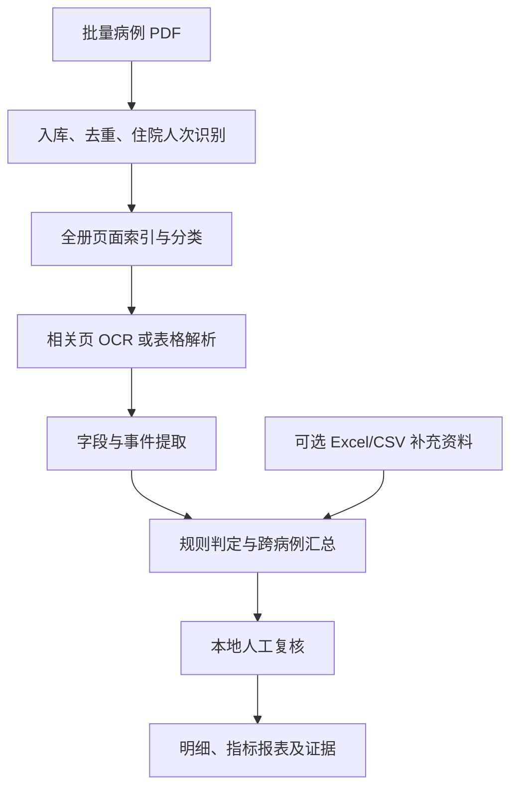

# 病例 PDF 指标统计系统实施规划

编制日期：2026-10-03

## 1. 目标与数据范围

输入一批病例 PDF，根据监测指标的统计口径，提取原始事实和病历事件，输出病例明细、分子分母、指标结果及证据。系统支持本地运行，目前不接 HIS。

默认结果名称为“提交病案集合的指标统计”。若医院确认输入涵盖统计期内全部符合要求的住院人次，且指标所需资料齐全，才可用于对应全量统计。输入只是抽样时，报表明确标为样本统计。

已检查的项目条件：

- 当前目录有原始病例 PDF、医院提示词 XLSX、2025 年版指标 PDF；尚无程序代码。
- 示例病例为 168 页扫描病案，含打印病历、表格、医嘱、护理、检查图像及手写内容。
- 提示词表共 51 项：35 项核心制度监测指标及 16 项关键诊疗行为监测指标。来源：工作表1，B2:B36、B39:B54。
- 当前电脑为 Windows，RTX 4060 Laptop GPU，显存约 8 GB。

本计划不要求三套 OCR 对所有页面依次重复识别。采用一个主力识别流程，表格及困难页面再按需处理。

## 2. 先核对统计口径

为 51 项指标建立一份规则清单，每项记录：统计期间依据、统计对象、计数单位、分子条件、分母条件、排除条件、所需字段、证据文书、缺失处理及依据版本。

计数单位逐项确认，不能都输出病例级 0/1。有的统计住院人次，有的统计会诊次数、手术台次、危急值条目、术种数量或项目种类；中位数和发生率比另用专门计算函数。

医院提示词作为提取指导，与官方定义和公式核对后转成规则。文件中的文字作为资料解析，不作为程序可执行指令。

已发现需要优先核对的项目：

| 项目 | 提示词问题或资料缺口 | 处理方式 |
|---|---|---|
| 指标一 | 提示词按转科记录时间判断，同时又称转科操作时间；两者可能不同 | 分别保存实际事件时间和文书记录时间。使用哪一个须在口径清单中说明，不静默互换 |
| 指标二 | 名称是“8小时内查房率”，定义和公式实际依据检查或治疗医嘱 | 按定义、公式提取医嘱时间，不能只搜索查房记录 |
| 指标二十 | F21 将分母写成死亡病例，与 D21 中“发生医疗纠纷的死亡病例”不一致 | 标记提示词冲突；需要纠纷资料，缺失时不能计算正式比值 |
| 指标二十二 | E23、F23 都仅判断是否有死亡医嘱，无法判断病案是否完整上传 | 需要应上传清单和实际上传结果，单凭 PDF 不能计算上传率 |
| 指标二十九 | 分母是备案的三、四级手术术种数 | 支持医院备案目录的 Excel/CSV 导入；PDF 只提供实际开展的术种 |
| 指标三十 | 需要跨年度的新技术项目台账 | 支持台账文件导入；病例只能补充开展证据 |

没有 HIS 接口仍可接收医院提供的 Excel/CSV 补充文件。没有补充文件的项目输出具体缺失原因，不能用另一个可获得的数字代替分母。

## 3. 处理流程



### 3.1 入库与住院人次识别

- 原始文件保留；计算文件哈希，避免完全相同的文件重复导入。
- 提取住院号、入院时间等，建立住院人次标识。多个文件属于同次住院时合并，同一个人不同次住院分别计数。
- 哈希去重不足以识别同一病案的重扫版本，还需比较住院人次标识。
- 识别不了住院人次、一个 PDF 混有多次住院、疑似重复时进入复核队列。
- 每批保存统计期间、样本或全量的声明、文件数量、住院人次数和处理失败项。

### 3.2 页面索引与按需识别

- 有有效文字层的 PDF 先直接提取文字；扫描页才进入 OCR。
- 全册先识别标题或少量文字，分类为首页、入院、出院、病程、转科、会诊、讨论、手术、麻醉、医嘱、护理、检验、影像、同意书等。
- 标题不足时结合版面和正文分类。无法分类的页保留为待核查，不丢弃。
- 分类阶段漏掉关键页会造成漏报，因此这一步本身要验收。
- 根据指标选页高精度识别；遇到缺少文书、相互矛盾或时间断档时扩大搜索范围。
- 保存原始 PDF 页码、文字位置、识别文字及识别状态。旋转后的图像坐标可映射回原页。
- 首轮按约 250–300 DPI 渲染相关页，并对小字区域裁切识别。放大不会恢复原扫描中已经缺失的信息。

### 3.3 字段和事件提取

先用确定规则提取格式固定的字段；涉及叙述、否定和关联关系的内容，再使用本地语义模型。每份文书分别处理，按同次住院合并事件。

事件记录至少包含：住院人次标识、事件类型、实际事件时间、文书记录时间、相关科室或人员、原文证据、页码和位置、缺失或冲突信息。

例如转科事件必须区分：已发生转科、计划转科、会诊、去检查或手术地点、病区内换床、既往转科。ICU 属性用医院科室字典映射；无法确认时不猜测。

时间字段分别保存。文书记录时间、事件发生时间、签名时间、完成或提交时间不能默认相同；文件创建日期不能证明病历完成时间。

本地语义模型只输出受约束的结构化事实和证据。程序检查 JSON 结构、时间格式、证据是否出现在输入文字中以及必要字段；模型无依据的补全不进入统计。

### 3.4 规则判定与汇总

每项指标独立输出分母资格和分子判定：

- 分母资格：符合、不符合、无法判定。
- 分子判定：符合、不符合、无法判定；分母不符合时为不适用。

“没有检索到记录”默认不能直接当作 0。若某项指标以文书是否存在为条件，需另有经医院确认的归档完整性规则。

所有时间比较、排除、去重和计数由程序执行，保留所用规则版本。分母为 0 时输出不适用；缺失资料时输出无法计算。

跨病例指标单独汇总。例如手术医师和麻醉医师时间重合，需要收集多份病案中的人员和时间区间；不能通过每份 PDF 各自输出 0/1 完成。非计划再次住院需要可关联的住院历史，并报告历史覆盖不足。

## 4. 模型与技术选择

| 模块 | 首轮选择 | 选择原则 |
|---|---|---|
| PDF 读取与渲染 | Python + PDF 提取/渲染库 | 保留原始页码，支持文字层与扫描页分流 |
| 打印文字 OCR | PP-OCRv6_medium 候选，PP-OCRv5_server 对照 | 在本病例代表页上比较关键字段准确率、兼容性和速度后固定版本 |
| 表格与版面 | 按需使用 PP-StructureV3 | 这是含 OCR 的解析流程，避免与主力流程重复识别整册 |
| 困难页补识别 | 按需评估 PaddleOCR-VL-1.6 | 仅处理常规流程失败的关键页；与原图核对，不把生成文字视为必然正确 |
| 语义理解 | 本地文本模型，型号由小样本与显存试跑决定 | 检验否定、事件时间、科室关联及证据提取；确定规则能完成的字段不调用模型 |
| 数据校验与规则 | Python + 结构化校验 + 配置文件 | 同一输入和规则可重复计算 |
| 存储 | SQLite + 本地文件 | 先支持单机批量任务；有并发需要后再升级 |
| 操作方式 | 先命令行，后本地复核界面 | 先保证计算链条，再提供导入、查看证据、修改判定和导出 |

安装使用项目独立虚拟环境，不覆盖现有 Anaconda 环境。模型下载到项目模型目录，固定依赖与模型版本；运行病例时使用本地缓存模型。

8 GB 显存下先采用单页或小批次推理，各模型分阶段加载。是否需要 WSL2/Linux 根据具体推理后端确定；第一阶段不先搭建复杂服务。

模型资料：

- [通用 OCR 使用与模型下载](https://www.paddleocr.ai/main/en/version3.x/pipeline_usage/OCR.html)
- [PP-StructureV3](https://www.paddleocr.ai/latest/en/version3.x/pipeline_usage/PP-StructureV3.html)
- [PaddleOCR-VL 本地部署](https://www.paddleocr.ai/latest/en/version3.x/pipeline_usage/PaddleOCR-VL.html)

公共评测结果不能代替本院病历验收。先使用现成模型，不立即训练或微调；只有确认存在稳定、重复的识别问题后，再考虑补充标注与训练。

## 5. 先完成指标一与指标二

### 指标一：入院 48 小时内转科的比例

1. 取得入院时间及其证据。
2. 检索转出、转入、转科以及病程、医嘱、护理中的实际转科事件。
3. 将转入、转出科室与 ICU 字典匹配。
4. 按已确认的时间口径，判断是否存在时间差在 0 至 48 小时内的非 ICU 转科事件。
5. 同次住院符合条件时计一次；多次住院分别处理。
6. 没有找到事件、证据覆盖不足或时间冲突时，输出待核实及原因。

此前示例病案的“暂计 0”只作为阅读后的初步判断，不能作为自动程序的人工正确答案。没有补充证据或经确认的完整性判定前，验收样本中应保留不确定状态。

### 指标二：入院 8 小时内查房率

按官方定义及医院表中的公式，判断入院 8 小时内是否开具检查或治疗医嘱。区分医嘱开立时间和执行时间；药品、护理、检查等类别依据约定字典映射。不能仅凭“查房记录”字样判断符合。

这两项分别检验事件语义识别、表格时间提取、规则计算以及资料缺失处理，为后续指标复用提供基础。

## 6. 分阶段实施与验收

| 阶段 | 工作 | 交付物与完成条件 |
|---|---|---|
| 1. 口径与资料清单 | 核对 51 项定义、提示词冲突、计数单位、PDF 可提供证据及缺失资料 | 指标规则清单、补充资料清单、第一批指标范围；有歧义项明确标记 |
| 2. PDF 与 OCR 基础 | 建环境，试识别代表页，做入库去重、分类、按需识别和缓存 | 每页可追溯的文字与版面结果；失败页可定位并重跑；模型版本固定 |
| 3. 指标一、二闭环 | 提取入院、转科、医嘱事实，实现规则与明细输出 | 从输入 PDF 到病例贡献、批次结果和证据的完整链条；缺资料不强行输出 0 |
| 4. 人工复核与批量验收 | 增加本地查看证据、修改判定、记录理由、重新汇总和导出 | 人工修改可追溯且不覆盖原始提取；新批次可独立运行 |
| 5. 扩展指标 | 优先文书和时间类，再做语义、跨病例与补充台账类 | 逐项验收；不能仅凭 PDF 完成的项目仍保留明确的无法计算状态 |

初始代表页覆盖病案首页、打印病程、医嘱表、护理表、横向页、手写关键时间及低清页。先用示例病案打通流程，再用不同来源的 5–10 份病案检验页面分类和格式差异。

正式验收需要医院人工标注的独立病例集合，初步可准备 30–50 份，并主动覆盖实际转科、ICU 转入转出、48 小时边界、未转科和记录缺失等情况。不能只测试当前这一份病案，也不能从同一患者拆出训练与验收样本。

验收分别检查关键页召回、日期时间准确性、事件漏报与误报、病例判定及分子分母一致性。负例和不确定例也需要核对。具体可接受阈值由医院使用目的和人工验收结果确定，试跑前不承诺固定准确率。

规则计算测试覆盖：0/48/超过48小时、转科发生在入院前、ICU 排除、同次多次转科、同人再次住院、重复 PDF、缺失时间、时间冲突、跨统计期间和分母为零。

## 7. 结果报表

第一版输出两类结果：

1. 指标汇总：统计期间、样本或全量标识、计数单位、已知分母、已知分子、无法判定数量、处理失败数量、规则版本及缺失原因。
2. 判定明细：每个住院人次或事件对指标的贡献，使用的时间和条件，证据页码、原文、人工复核结果。

分母已知且分子有 U 个待判定对象时，可展示保守范围 P/D 至 (P+U)/D，其中 P 为明确符合分子的数量、D 为符合分母的数量。该范围是本次输入集合的不确定性说明，不代替官方最终指标。分母资格本身未知时，不能套用这个范围。

人工复核保留原始模型结果，另存修订结果、修订理由和时间；修订后重新汇总。OCR 置信分数只辅助安排复核，不作为指标准确率。

## 8. 保密与项目组织

病例识别和语义提取在本机或医院授权的本地环境运行，不调用外部病例处理 API。模型权重可提前下载；处理病例时不需要对外联网。

原始文件、OCR 文字、页图和事件数据都按病例敏感数据管理。日志使用内部标识，不打印姓名、证件号码或整页原文；导出报告按需要限制身份字段。原始文件不修改，临时页图可按保留策略清理。

建议实现时的目录结构如下；本次只生成规划文件，不安装模型、不开始正式统计：

```text
OCR/
  原始输入文件（当前已有）
  src/                 程序模块
  config/              指标口径、科室及术式字典
  models/              本地模型与版本清单
  data/                SQLite、批次和事件数据
  work/                页图、OCR 缓存及临时文件
  outputs/             汇总、明细和规划文档
  tests/               规则边界与人工标注验收样本
  requirements.lock    试跑确认后的依赖版本
```

第一步应完成口径清单，并建立示例病案的页面索引与关键页 OCR 结果；随后落实指标一、二的证据提取与规则计算。
